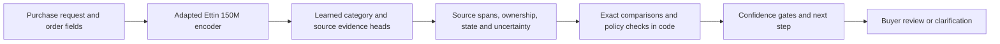

# Architecture

The text encoder is pretrained; task heads and encoder adaptation are our
training work. Exact numeric checks use code over learned extraction. A missed
or incorrect extraction remains a failure risk. Unresolved or uncertain evidence
can require clarification. References are optional evidence, not product search.

Supported categories: motors, conveyor rollers, gearboxes, drive belts,
bearings and inductive proximity sensors. Out-of-scope requests have bounded
routing outcomes. The runtime uses PyTorch on CPU with two threads by default.
Training used an NVIDIA L4 on SAP AI Core. Inference requires neither that
service nor an inference GPU after downloading the saved bundle.

The neural inference sources are byte-identical to the research candidate,
including their recorded hashes. This public snapshot has a fresh Git history.
